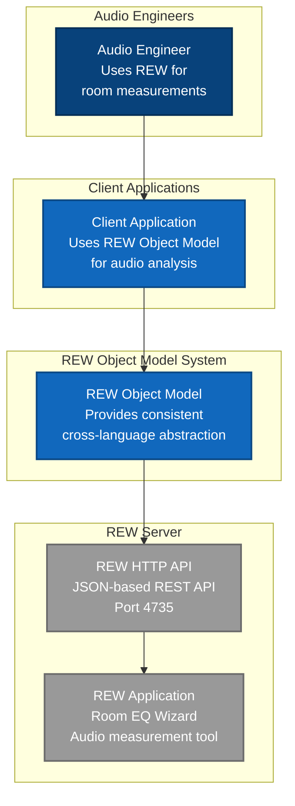
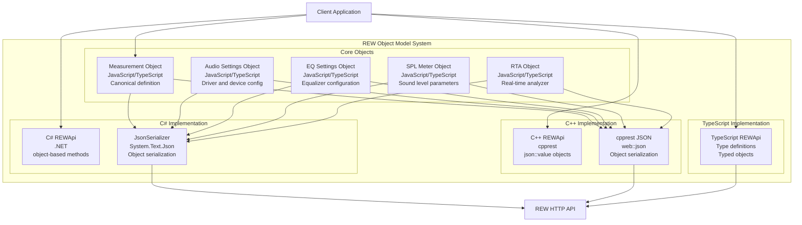
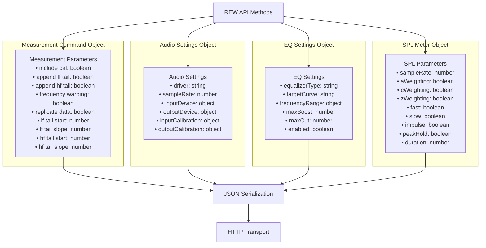

# REW Object Model Architecture

## 1. Introduction

### 1.1 Purpose
This document describes the REW (Room EQ Wizard) Object Model architecture following ISO/IEC/IEEE 42010:2011 standard. The object model provides a consistent, language-agnostic abstraction for REW API interactions across C#, C++, JavaScript, and TypeScript implementations.

### 1.2 Scope
This architecture addresses the object model requirements derived from existing JavaScript/TypeScript implementations and provides blueprints for cross-language consistency in REW API client libraries.

### 1.3 Stakeholders and Concerns

| Stakeholder | Concerns |
|-------------|----------|
| Audio Engineers | Usability, Measurement accuracy, REW compatibility |
| API Developers | Maintainability, Cross-language consistency, Type safety |
| Library Users | Simple API surface, Predictable behavior, Documentation |
| REW Server | Protocol compliance, Data format consistency, Performance |

## 2. Architecture Overview

### 2.1 Architecture Style
**Multi-Language Object Model** with consistent abstraction across implementations

### 2.2 Key Architecture Principles
- **Cross-Language Consistency**: Identical object structures across C#, C++, JS, TS
- **REW Protocol Compliance**: Objects map directly to REW API JSON structures
- **Simple Object Pattern**: Use native language objects, not complex domain models
- **Zero HTTP Exposure**: No HttpContent or HTTP details in public APIs
- **JSON Transparency**: Objects serialize directly to REW-expected JSON

### 2.3 Quality Attributes

| Quality Attribute | Measure | Target |
|-------------------|---------|--------|
| Consistency | Cross-language API parity | 100% method signature consistency |
| Usability | API complexity | Simple object parameters only |
| Maintainability | Object model changes | Single source of truth (JS/TS) |
| Performance | Serialization overhead | <1ms for typical objects |
| Reliability | Type safety | Compile-time validation where possible |

## 3. Object Model Views

### 3.1 Context View - REW Object Model in Ecosystem



### 3.2 Container View - Object Model Structure



### 3.3 Component View - Object Model Core Components



## 4. REW Domain API Architecture

### 4.1 Layered Architecture (Clean Boundaries)

Following battle-tested patterns for REW API characteristics with proper separation of concerns:

#### 4.1.1 Architecture Layers

```
┌─────────────────────────────────────────────────────────┐
│ Domain Layer (Public API)                               │
│ ┌─────────────────┐ ┌─────────────────┐ ┌──────────────┐ │
│ │ ApplicationSvc  │ │ AudioService    │ │ MeasureSvc   │ │
│ │ - shutdown()    │ │ - configJava()  │ │ - runSweep() │ │
│ │ - blocking()    │ │ - setASIO()     │ │ - process()  │ │
│ │ - errors()      │ │ - sampleRates() │ │ - export()   │ │
│ └─────────────────┘ └─────────────────┘ └──────────────┘ │
├─────────────────────────────────────────────────────────┤
│ Gateway Layer (Handwritten Adaptors)                    │
│ ┌─────────────────┐ ┌─────────────────┐ ┌──────────────┐ │
│ │ CommandGate     │ │ LongRunningJob  │ │ ArrayCodec   │ │
│ │ - queue POSTs   │ │ - 200/202 logic │ │ - Base64 BE  │ │
│ │ - single-flight │ │ - polling       │ │ - float[]    │ │
│ └─────────────────┘ └─────────────────┘ └──────────────┘ │
├─────────────────────────────────────────────────────────┤
│ Transport Layer (Auto-Generated from OpenAPI)           │
│ ┌─────────────────┐ ┌─────────────────┐ ┌──────────────┐ │
│ │ RewHttpClient   │ │ DTOs            │ │ Swagger Gen  │ │
│ │ - HTTP calls    │ │ - wire format   │ │ - from spec  │ │
│ │ - retries       │ │ - serialization │ │ - localhost  │ │
│ └─────────────────┘ └─────────────────┘ └──────────────┘ │
└─────────────────────────────────────────────────────────┘
```

#### 4.1.2 Domain Services Pattern

**Principle**: Model resources as cohesive types following REW's API resource structure

**C# Implementation (Battle-Tested Pattern)**:
```csharp
// RewClient - main facade
var rew = await RewClient.ConnectAsync("localhost:4735");

// Domain services mirror API resource trees
await rew.Application.EnableBlocking(true);
await rew.Audio.ConfigureJava("Built-in Input", "Built-in Output", 48000);

// High-level workflow methods
var result = await rew.Measurements.RunSweepAndExport(new SweepConfig
{
    StartFreq = 20,
    EndFreq = 20000,
    Length = 512,
    OutputPath = "room_response.mdat"
});

// Long-running operations with proper async handling
var job = await rew.Measurements.GenerateWaterfall(measurementId, new WaterfallOptions
{
    Mode = WaterfallMode.Fourier,
    Slices = 101,
    PPO = 48
});
var waterfallData = await job.AwaitCompletion();
```

**JavaScript/TypeScript Implementation**:
```javascript
// Create measurement with domain objects - RICH BEHAVIOR, NOT JUST DATA
const measurement = new MeasurementSummary({
    title: "Living Room Response",
    notes: "Automated measurement session",
    startFreq: 20.0,
    endFreq: 20000.0,
    inverted: false,
    rewVersion: "5.20.13",
    timingReference: "IR start",
    delay: 0.0,
    timingOffset: 0.0,
    signalToNoisedB: 45.2,
    splOffsetdB: 0.0,
    alignSPLOffsetdB: 0.0
});

// OBJECT-ORIENTED METHODS - NOT JSON MANIPULATION!
await measurement.load();                    // Load full measurement data
await measurement.saveAll();                 // Save complete measurement  
const diracResult = await measurement.dirac(); // Generate Dirac pulse response

// Domain-specific operations with proper parameters
const waterfall = await measurement.generateWaterfall({
    mode: "Fourier",
    slices: 101,
    ppo: 48,
    windowType: "Hann",
    timeRangeMs: 500
});
```

**C++ Implementation**:
```cpp
// Create measurement with domain objects
auto measurement = std::make_unique<Measurement>("Living Room Response");
measurement->SetIncludeCalibration(true);

auto processing = std::make_unique<MeasurementProcessing>();
processing->SetAppendLowFrequencyTail(true);
processing->SetLowFrequencyTailStart(1000.0);
processing->SetLowFrequencyTailSlope(6.0);
processing->SetFrequencyWarping(true);
measurement->SetProcessingOptions(std::move(processing));

auto result = measurement->ProcessAsync("Smooth");
```

#### 4.1.2 Encapsulation Principle

**Domain Abstraction**: Classes represent REW concepts, not data transfer objects
- Hide HTTP/JSON serialization completely
- Provide meaningful business methods
- Encapsulate validation within domain objects
- Use composition for complex domain relationships

**Examples**:
- ✅ `measurement.ProcessAsync("Smooth")` (domain method)
- ❌ `rewApi.issueMeasurementCommand(json)` (JSON exposure)
- ✅ `audioDevice.Configure(driver, sampleRate)` (meaningful operation)
- ❌ `rewApi.updateAudioSettings(data)` (generic data)

### 4.2 REW Domain Object Definitions (Based on Actual REW API)

### 4.2 REW Domain Services (Resource-Centric Design)

Following REW API documentation structure with one service per top-level resource tree:

#### 4.2.1 ApplicationService 

**Maps to**: `/application/*` endpoints  
**Purpose**: Application control, blocking mode, diagnostics

```csharp
/// <summary>
/// REW Application control and system-level operations
/// Maps to /application/* endpoints in REW API
/// </summary>
public class ApplicationService
{
    private readonly CommandGate _commandGate;
    private readonly RewHttpClient _httpClient;

    // Application control methods
    
    /// <summary>
    /// Shutdown REW application cleanly
    /// Maps to POST /application/shutdown
    /// </summary>
    public async Task Shutdown();
    
    /// <summary>
    /// Enable/disable blocking mode for scripts
    /// Maps to PUT /application/blocking-mode
    /// Persisted across REW sessions
    /// </summary>
    public async Task EnableBlocking(bool enable = true);
    
    /// <summary>
    /// Get current application status
    /// Maps to GET /application
    /// </summary>
    public async Task<ApplicationStatus> GetStatus();
    
    /// <summary>
    /// Clear any command currently in progress (emergency stop)
    /// Maps to POST /application/clear-command-in-progress
    /// </summary>
    public async Task ClearCommandInProgress();
    
    /// <summary>
    /// Subscribe to application errors and warnings
    /// Maps to /application/errors and /application/warnings
    /// Returns IDisposable for cleanup
    /// </summary>
    public IDisposable SubscribeToErrors(Action<ApplicationError> onError);
    public IDisposable SubscribeToWarnings(Action<ApplicationWarning> onWarning);
    
    /// <summary>
    /// Toggle debug logging and get log file path
    /// Maps to PUT /application/logging
    /// </summary>
    public async Task<string> EnableLogging(bool enable = true);
    
    /// <summary>
    /// Get REW version and API capabilities
    /// Maps to GET /application/version
    /// </summary>
    public async Task<REWVersion> GetVersion();
}

public class ApplicationStatus
{
    public string Version { get; set; }
    public bool BlockingMode { get; set; }
    public bool CommandInProgress { get; set; }
    public string CurrentCommand { get; set; }
    public bool LoggingEnabled { get; set; }
    public string LogFilePath { get; set; }
}
```

#### 4.2.2 AudioService

**Maps to**: `/audio/*` endpoints  
**Purpose**: Audio driver configuration, calibration, state management

```csharp
/// <summary>
/// REW Audio system configuration and management
/// Maps to /audio/* endpoints with proper state management
/// </summary>
public class AudioService
{
    private readonly CommandGate _commandGate;
    private readonly RewHttpClient _httpClient;
    private AudioState _cachedState;

    // High-level configuration methods
    
    /// <summary>
    /// Configure Java audio with automatic fallbacks
    /// Handles samplerate negotiation and error recovery
    /// </summary>
    public async Task ConfigureJava(string inputDevice, string outputDevice, int sampleRate);
    
    /// <summary>
    /// Configure ASIO audio with device validation
    /// Includes automatic driver reload if needed
    /// </summary>
    public async Task ConfigureASIO(string device, string input, string output, int sampleRate);
    
    /// <summary>
    /// Get available sample rates for current driver
    /// Maps to GET /audio/sample-rates
    /// </summary>
    public async Task<int[]> GetSupportedSampleRates();
    
    /// <summary>
    /// Switch audio driver type with state invalidation
    /// Maps to PUT /audio/driver
    /// </summary>
    public async Task SetDriver(AudioDriverType driver);
    
    // Java-specific methods (maps to /audio/java/*)
    
    /// <summary>
    /// Get Java audio configuration
    /// Maps to GET /audio/java
    /// </summary>
    public async Task<JavaAudioConfig> GetJavaConfig();
    
    /// <summary>
    /// Update Java audio settings
    /// Maps to PUT /audio/java
    /// </summary>
    public async Task UpdateJavaConfig(JavaAudioConfig config);
    
    /// <summary>
    /// Get available Java input/output devices
    /// Maps to GET /audio/java/devices
    /// </summary>
    public async Task<JavaDevices> GetJavaDevices();
    
    // ASIO-specific methods (maps to /audio/asio/*)
    
    /// <summary>
    /// Get ASIO audio configuration
    /// Maps to GET /audio/asio
    /// </summary>
    public async Task<ASIOAudioConfig> GetASIOConfig();
    
    /// <summary>
    /// Update ASIO audio settings
    /// Maps to PUT /audio/asio
    /// </summary>
    public async Task UpdateASIOConfig(ASIOAudioConfig config);
    
    /// <summary>
    /// Reload ASIO driver (useful after hardware changes)
    /// Maps to POST /audio/asio/reload-driver
    /// </summary>
    public async Task ReloadASIODriver();
    
    // Calibration methods
    
    /// <summary>
    /// Update input calibration settings
    /// Maps to PUT /audio/input-calibration
    /// </summary>
    public async Task UpdateInputCalibration(CalibrationConfig config);
    
    /// <summary>
    /// Update output calibration settings
    /// Maps to PUT /audio/output-calibration
    /// </summary>
    public async Task UpdateOutputCalibration(CalibrationConfig config);
    
    // State management
    
    /// <summary>
    /// Refresh cached audio state from REW
    /// Call after external changes or errors
    /// </summary>
    public async Task RefreshState();
    
    /// <summary>
    /// Get current audio state (cached with refresh option)
    /// Maps to GET /audio
    /// </summary>
    public async Task<AudioState> GetState(bool forceRefresh = false);
}

public enum AudioDriverType
{
    Java,
    ASIO
}

public class AudioState
{
    public bool AudioEnabled { get; set; }
    public bool AudioEndpointsReady { get; set; }
    public AudioDriverType Driver { get; set; }
    public int SampleRate { get; set; }
    public int[] SupportedSampleRates { get; set; }
    public bool Treat32BitAs24Bit { get; set; }
    public JavaAudioConfig Java { get; set; }
    public ASIOAudioConfig ASIO { get; set; }
}
```

#### 4.2.3 MeasurementsService

**Maps to**: `/measurements/*` endpoints  
**Purpose**: Measurement lifecycle, processing, export workflows

```csharp
/// <summary>
/// REW Measurements management with high-level workflow methods
/// Maps to /measurements/* endpoints plus common automation patterns
/// </summary>
public class MeasurementsService
{
    private readonly CommandGate _commandGate;
    private readonly RewHttpClient _httpClient;
    private readonly ArrayCodec _arrayCodec;

    // High-level workflow methods
    
    /// <summary>
    /// Complete measurement workflow: sweep + process + export
    /// Handles hardware setup, timing, and error recovery
    /// </summary>
    public async Task<MeasurementResult> RunSweepAndExport(SweepConfig config);
    
    /// <summary>
    /// Batch process multiple measurements with common settings
    /// Efficient for room correction workflows
    /// </summary>
    public async Task<ProcessingResult[]> ProcessBatch(
        string[] measurementIds, 
        ProcessingOptions options);
    
    // Core measurement operations
    
    /// <summary>
    /// List all measurements with optional filtering
    /// Maps to GET /measurements
    /// </summary>
    public async Task<MeasurementSummary[]> ListMeasurements(MeasurementFilter filter = null);
    
    /// <summary>
    /// Get full measurement data including arrays
    /// Maps to GET /measurements/:id with data decoding
    /// </summary>
    public async Task<MeasurementData> GetMeasurement(string measurementId);
    
    /// <summary>
    /// Delete measurement
    /// Maps to DELETE /measurements/:id
    /// </summary>
    public async Task DeleteMeasurement(string measurementId);
    
    // Processing operations (returns LongRunningJob)
    
    /// <summary>
    /// Generate waterfall plot with progress tracking
    /// Maps to POST /measurements/:id/command "Generate waterfall"
    /// </summary>
    public async Task<LongRunningJob<WaterfallResult>> GenerateWaterfall(
        string measurementId, 
        WaterfallOptions options);
    
    /// <summary>
    /// Generate RT60 analysis
    /// Maps to POST /measurements/:id/command "Generate RT60"
    /// </summary>
    public async Task<LongRunningJob<RT60Result>> GenerateRT60(
        string measurementId, 
        RT60Options options);
    
    /// <summary>
    /// Apply smoothing to measurement
    /// Maps to POST /measurements/:id/command "Smooth"
    /// </summary>
    public async Task<LongRunningJob<ProcessingResult>> Smooth(
        string measurementId, 
        SmoothingOptions options);
    
    // Data access with proper array decoding
    
    /// <summary>
    /// Get frequency response with decoded float arrays
    /// Maps to GET /measurements/:id/frequency-response
    /// </summary>
    public async Task<FrequencyResponseData> GetFrequencyResponse(
        string measurementId, 
        string unit = "SPL", 
        string smoothing = null, 
        int? ppo = null);
    
    /// <summary>
    /// Get impulse response with decoded data
    /// Maps to GET /measurements/:id/impulse-response
    /// </summary>
    public async Task<ImpulseResponseData> GetImpulseResponse(
        string measurementId,
        string unit = "Percent",
        bool windowed = false,
        bool normalised = true);
    
    /// <summary>
    /// Export measurement to file
    /// Maps to POST /measurements/:id/export
    /// </summary>
    public async Task ExportMeasurement(
        string measurementId, 
        string filePath, 
        ExportFormat format = ExportFormat.MDAT);
}

public class SweepConfig
{
    public double StartFreq { get; set; } = 20;
    public double EndFreq { get; set; } = 20000;
    public double Length { get; set; } = 512; // k samples
    public double Level { get; set; } = -12; // dBFS
    public int Repetitions { get; set; } = 1;
    public double StartDelay { get; set; } = 0;
    public bool CaptureNoiseFloor { get; set; } = false;
    public string OutputPath { get; set; }
    public string Notes { get; set; }
}

public class MeasurementResult
{
    public string MeasurementId { get; set; }
    public MeasurementSummary Summary { get; set; }
    public string ExportPath { get; set; }
    public ProcessingMetrics Metrics { get; set; }
}
```

#### 4.2.4 Supporting Infrastructure Classes

**Purpose**: Handle REW-specific quirks and concurrency patterns

```csharp
/// <summary>
/// Handles REW's single-command-in-progress constraint
/// Queues POST operations and provides emergency clear
/// </summary>
public class CommandGate
{
    private readonly SemaphoreSlim _gate = new(1, 1);
    private readonly ApplicationService _application;

    public async Task<T> ExecuteCommand<T>(Func<Task<T>> command);
    public async Task ClearInProgress();
}

/// <summary>
/// Handles REW's 200 (immediate) vs 202 (long-running) response pattern
/// Provides unified async interface with progress reporting
/// </summary>
public class LongRunningJob<T>
{
    public bool IsCompleted { get; }
    public bool IsBlocking { get; }
    public string JobId { get; }
    
    public async Task<T> AwaitCompletion(CancellationToken cancellationToken = default);
    public async Task<T> AwaitCompletion(IProgress<JobProgress> progress, CancellationToken cancellationToken = default);
    public async Task Cancel();
}

/// <summary>
/// Handles REW's Base64 big-endian float array encoding
/// Centralizes array decode/encode with performance optimizations
/// </summary>
public class ArrayCodec
{
    /// <summary>
    /// Decode REW Base64 float array (big-endian)
    /// Tested against sample vectors from REW docs
    /// </summary>
    public static float[] DecodeFloatArray(string base64Data);
    
    /// <summary>
    /// Encode float array to REW format
    /// </summary>
    public static string EncodeFloatArray(float[] data);
    
    /// <summary>
    /// Zero-copy decode when possible (unsafe context)
    /// </summary>
    public static unsafe Span<float> DecodeFloatArrayUnsafe(string base64Data);
}

/// <summary>
/// Manages REW subscription endpoints with auto-renewal
/// Handles server push notifications via embedded HTTP listener
/// </summary>
public class SubscriptionManager : IDisposable
{
    public IDisposable Subscribe<T>(string endpoint, Action<T> handler);
    public void UnsubscribeAll();
    public void Dispose();
}
```

### 4.3 RewClient - Main Facade

**Purpose**: Primary entry point providing unified access to all REW domain services

```csharp
/// <summary>
/// Main REW API client facade
/// Provides unified access to all REW services with proper lifecycle management
/// </summary>
public class RewClient : IDisposable
{
    private readonly RewHttpClient _httpClient;
    private readonly CommandGate _commandGate;
    private readonly SubscriptionManager _subscriptionManager;
    private readonly ArrayCodec _arrayCodec;

    // Domain service properties
    public ApplicationService Application { get; }
    public AudioService Audio { get; }
    public MeasurementsService Measurements { get; }
    public GroupsService Groups { get; }
    public MeasureService Measure { get; }
    public GeneratorService Generator { get; }
    public SPLMeterService SPLMeters { get; }
    public RTAService RTA { get; }
    public ImportService Import { get; }
    public RoomSimulatorService RoomSimulator { get; }

    // Factory methods with proper connection handling
    
    /// <summary>
    /// Connect to running REW instance
    /// Tests connection and retrieves version info
    /// </summary>
    public static async Task<RewClient> ConnectAsync(string baseUrl = "http://localhost:4735");
    
    /// <summary>
    /// Ensure REW is running and connect
    /// Launches REW with API flags if needed
    /// </summary>
    public static async Task<RewClient> EnsureRunningAndConnect(REWLaunchOptions options = null);
    
    // Connection management
    
    /// <summary>
    /// Test connection to REW API
    /// </summary>
    public async Task<bool> TestConnection();
    
    /// <summary>
    /// Get REW version and API capabilities
    /// </summary>
    public async Task<REWVersion> GetVersion();
    
    /// <summary>
    /// Clean shutdown - stops subscriptions and closes REW if launched by us
    /// </summary>
    public async Task Shutdown();
    
    public void Dispose();
}

/// <summary>
/// Options for launching REW with API support
/// </summary>
public class REWLaunchOptions
{
    public bool NoGUI { get; set; } = true;
    public bool EnableAPI { get; set; } = true;
    public string Host { get; set; } = "localhost";
    public int Port { get; set; } = 4735;
    public string REWExecutablePath { get; set; }
    public string[] AdditionalArgs { get; set; }
}

/// <summary>
/// REW version and capability information
/// </summary>
public class REWVersion
{
    public string Version { get; set; }
    public string BuildDate { get; set; }
    public string APIVersion { get; set; }
    public string OpenAPIHash { get; set; }
    public bool IsProVersion { get; set; }
    public string[] SupportedFeatures { get; set; }
}
```

### 4.4 Usage Examples - Battle-Tested Patterns

#### 4.4.1 Simple Room Measurement

```csharp
// Connect to REW
var rew = await RewClient.ConnectAsync();

// Enable blocking mode for script-like behavior
await rew.Application.EnableBlocking(true);

// Configure audio system
await rew.Audio.ConfigureJava("Built-in Input", "Built-in Output", 48000);

// Run complete measurement workflow
var result = await rew.Measurements.RunSweepAndExport(new SweepConfig
{
    StartFreq = 20,
    EndFreq = 20000,
    Length = 512,
    Notes = "Living room measurement",
    OutputPath = "room_response.mdat"
});

Console.WriteLine($"Measurement completed: SNR {result.Metrics.SNR:F1} dB");
```

#### 4.4.2 Advanced Processing with Progress

```csharp
// Connect and setup
var rew = await RewClient.ConnectAsync();
var measurementId = "existing-measurement-uuid";

// Generate waterfall with progress reporting
var waterfallJob = await rew.Measurements.GenerateWaterfall(measurementId, new WaterfallOptions
{
    Mode = WaterfallMode.Fourier,
    Slices = 101,
    PPO = 48,
    WindowType = WindowType.Hann
});

var progress = new Progress<JobProgress>(p => 
    Console.WriteLine($"Waterfall generation: {p.PercentComplete}%"));

var waterfallData = await waterfallJob.AwaitCompletion(progress);

// Access decoded array data
float[] frequencies = waterfallData.Frequencies;
float[,] splData = waterfallData.DecodedSPLData; // 2D array ready for analysis
```

#### 4.4.3 Error Handling and Diagnostics

```csharp
var rew = await RewClient.ConnectAsync();

// Subscribe to REW errors and warnings
using var errorSub = rew.Application.SubscribeToErrors(error => 
    Console.WriteLine($"REW Error: {error.Message}"));

try
{
    await rew.Audio.ConfigureJava("Invalid Device", "Invalid Output", 96000);
}
catch (REWAudioException ex)
{
    // Exception includes available devices and supported sample rates
    Console.WriteLine($"Audio config failed: {ex.Message}");
    Console.WriteLine($"Available devices: {string.Join(", ", ex.AvailableDevices)}");
    Console.WriteLine($"Supported rates: {string.Join(", ", ex.SupportedSampleRates)}");
    
    // Fallback to first available device at supported rate
    var devices = await rew.Audio.GetJavaDevices();
    await rew.Audio.ConfigureJava(devices.InputDevices[0], devices.OutputDevices[0], 48000);
}
```

#### 4.4.4 Batch Processing

```csharp
var rew = await RewClient.ConnectAsync();

// Load multiple measurements
var measurements = await rew.Measurements.ListMeasurements();
var roomMeasurements = measurements.Where(m => m.Notes.Contains("room")).ToArray();

// Batch process with common settings
var processingResults = await rew.Measurements.ProcessBatch(
    roomMeasurements.Select(m => m.UUID).ToArray(),
    new ProcessingOptions
    {
        Smoothing = "1/12",
        GenerateRT60 = true,
        RT60OctaveFraction = 3,
        ExportFormat = ExportFormat.MDAT
    });

foreach (var result in processingResults)
{
    Console.WriteLine($"Processed {result.MeasurementId}: {result.Status}");
}
```

public class MeasurementProcessingOptions
{
    public bool IncludeCalibration { get; set; }
    public bool AppendLowFrequencyTail { get; set; }
    public double LowFrequencyTailStart { get; set; }  // Hz
    public double LowFrequencyTailSlope { get; set; }  // dB/octave, >= 0
    public bool AppendHighFrequencyTail { get; set; }
    public double HighFrequencyTailStart { get; set; } // Hz
    public double HighFrequencyTailSlope { get; set; } // dB/octave, <= 0
    public bool FrequencyWarping { get; set; }
    public bool ReplicateData { get; set; }
}
```

#### 4.2.2 AudioDevice Class

**Purpose**: Audio system configuration and control with exact API mapping

**Based on REW API endpoints**: `/audio/*`

**C# Class Definition**:
```csharp
/// <summary>
/// REW Audio Device management class
/// Maps directly to REW API /audio/* endpoints
/// </summary>
public class AudioDevice
{
    // Audio system status - exactly as returned by REW API
    public bool AudioEnabled { get; private set; }
    public bool AudioEndpointsReady { get; private set; }
    public AudioDriverType Driver { get; set; }
    public List<string> DriverTypes { get; private set; }
    public int SampleRate { get; set; }
    public List<int> SupportedSampleRates { get; private set; }
    public bool Treat32BitAs24Bit { get; set; }
    
    // Driver-specific settings
    public JavaAudioSettings Java { get; set; }
    public ASIOAudioSettings ASIO { get; set; }
    
    // Calibration settings
    public InputCalConfiguration InputCalibration { get; set; }
    public OutputCalConfiguration OutputCalibration { get; set; }

    // REW API Methods - exactly as documented in API reference
    
    /// <summary>
    /// Get current audio system status
    /// Maps to GET /audio
    /// </summary>
    public async Task<AudioStatus> GetStatus();
    
    /// <summary>
    /// Configure audio system
    /// Maps to POST /audio/configure
    /// </summary>
    public async Task Configure();
    
    /// <summary>
    /// Set audio driver type
    /// Maps to PUT /audio/driver
    /// </summary>
    public async Task SetDriver(AudioDriverType driver);
    
    /// <summary>
    /// Set sample rate
    /// Maps to PUT /audio/sample-rate
    /// </summary>
    public async Task SetSampleRate(int sampleRate, string unit = "Hz");
    
    /// <summary>
    /// Get supported sample rates for current driver
    /// Maps to GET /audio/sample-rates
    /// </summary>
    public List<int> GetSupportedSampleRates();
    
    /// <summary>
    /// Update input calibration
    /// Maps to PUT /audio/input-calibration
    /// </summary>
    public async Task UpdateInputCalibration(InputCalConfiguration config);
    
    /// <summary>
    /// Update output calibration  
    /// Maps to PUT /audio/output-calibration
    /// </summary>
    public async Task UpdateOutputCalibration(OutputCalConfiguration config);
    
    /// <summary>
    /// Get Java audio settings
    /// Maps to GET /audio/java
    /// </summary>
    public async Task<JavaAudioSettings> GetJavaSettings();
    
    /// <summary>
    /// Update Java audio settings
    /// Maps to PUT /audio/java
    /// </summary>
    public async Task UpdateJavaSettings(JavaAudioSettings settings);
    
    /// <summary>
    /// Get ASIO audio settings
    /// Maps to GET /audio/asio
    /// </summary>
    public async Task<ASIOAudioSettings> GetASIOSettings();
    
    /// <summary>
    /// Update ASIO audio settings
    /// Maps to PUT /audio/asio
    /// </summary>
    public async Task UpdateASIOSettings(ASIOAudioSettings settings);
}

public class JavaAudioSettings
{
    public string InputDevice { get; set; }
    public string Input { get; set; }
    public string OutputDevice { get; set; }
    public string Output { get; set; }
    public List<string> InputDevices { get; private set; }
    public List<string> Inputs { get; private set; }
    public List<string> OutputDevices { get; private set; }
    public List<string> Outputs { get; private set; }
    
    public int InputChannel { get; set; }
    public int RefInputChannel { get; set; }
    public int LastInputChannel { get; set; }
    public string OutputChannel { get; set; }
    public string RefOutputChannel { get; set; }
    public int NumInputChannels { get; private set; }
    public List<string> OutputChannels { get; private set; }
    public List<string> RefOutputChannels { get; private set; }
    
    public List<string> OutputChannelMapping { get; set; }
    public bool StereoOnly { get; set; }
}

public class ASIOAudioSettings
{
    public string Device { get; set; }
    public string Input { get; set; }
    public string Output { get; set; }
    public List<string> Devices { get; private set; }
    public List<string> Inputs { get; private set; }
    public List<string> Outputs { get; private set; }
    
    public string RefOutput { get; set; }
    public string RefInput { get; set; }
    public string LastInput { get; set; }
    public bool SecondaryOutputEnabled { get; set; }
    public string SecondaryOutput { get; set; }
    
    // Commands
    public async Task ReloadDriverAsync();
}

public enum AudioDriverType
{
    Java,
    ASIO
}
```

#### 4.2.3 SPLMeter Class

**Purpose**: Sound pressure level measurement

**Based on REW API endpoints**: `/spl-meter/*`

**C# Interface**:
```csharp
public class SPLMeter
{
    public int MeterNumber { get; private set; }
    public SPLMeterConfiguration Configuration { get; set; }
    public bool IsRunning { get; private set; }
    public SPLValues LastReading { get; private set; }

    // Domain methods
    public async Task StartAsync();
    public async Task StopAsync();
    public async Task ConfigureAsync(SPLMeterConfiguration config);
    public SPLValues GetCurrentLevels();
    
    // Subscription support
    public void Subscribe(string url, Dictionary<string, string> parameters = null);
    public void Unsubscribe(string url);
}

public class SPLMeterConfiguration
{
    public string Mode { get; set; }              // "SPL", etc.
    public string Weighting { get; set; }         // "A", "C", "Z"
    public string Filter { get; set; }            // "Fast", "Slow", "Impulse"
    public bool HighPassActive { get; set; }
    public bool RollingLeqActive { get; set; }
    public int RollingLeqMinutes { get; set; }
}

public class SPLValues
{
    public int MeterNumber { get; set; }
    public string Weighting { get; set; }
    public string Filter { get; set; }
    public double SPL { get; set; }
    public double Leq { get; set; }
    public bool IsRollingLeq { get; set; }
    public int RollingLeqMinutes { get; set; }
    public double Leq1m { get; set; }
    public double Leq10m { get; set; }
    public double SEL { get; set; }
    public double ElapsedTime { get; set; }
}
```

#### 4.2.4 RTAAnalyzer Class

**Purpose**: Real-time spectrum analysis

**Based on REW API endpoints**: `/rta/*`

**C# Interface**:
```csharp
public class RTAAnalyzer
{
    public RTAConfiguration Configuration { get; set; }
    public RTAAppearanceConfiguration AppearanceConfiguration { get; set; }
    public RTADistortionConfiguration DistortionConfiguration { get; set; }
    public RTAStatus Status { get; private set; }
    public string YAxisUnit { get; set; }
    public RTAGraphLimits GraphLimits { get; set; }
    public double CursorX { get; set; }
    
    // Current data
    public List<RTALevel> CurrentLevels { get; private set; }
    public FrequencyResponse CapturedData { get; private set; }
    public FrequencyResponse CapturedPeakData { get; private set; }
    public List<RTADistortion> DistortionResults { get; private set; }

    // Domain methods
    public async Task StartAsync();
    public async Task StopAsync();
    public async Task RestartAsync();
    public async Task SaveGraphImageAsync();
    public async Task ConfigureAsync(RTAConfiguration config);
    public List<RTALevel> GetLevels(string unit = "SPL");
    public FrequencyResponse GetCapturedData(string unit = "SPL", int? inputIndex = null);
    public FrequencyResponse GetCapturedPeakData(string unit = "SPL", int? inputIndex = null);
    public List<RTADistortion> GetDistortion(string unit = "SPL", string distortionUnit = "dB");
    
    // Subscription support
    public void SubscribeToStatus(string url);
    public void SubscribeToLevels(string url, string unit = "SPL");
    public void SubscribeToCapturedData(string url, string unit = "SPL", int? inputIndex = null);
    public void SubscribeToDistortion(string url, string unit = "SPL", string distortionUnit = "dB");
}

public class RTAStatus
{
    public bool Enabled { get; set; }
    public bool Running { get; set; }
}

public class RTALevel
{
    public long Timestamp { get; set; }         // nanoseconds
    public long SampleCount { get; set; }
    public double Level { get; set; }
}

public class RTADistortion
{
    public long Timestamp { get; set; }         // nanoseconds
    public long SampleCount { get; set; }
    public double FundamentalLevel { get; set; }
    public double THDLevel { get; set; }
    public double THDRelative { get; set; }
    public List<double> HarmonicLevels { get; set; }
    public List<double> HarmonicRelative { get; set; }
}
```

#### 4.2.5 Generator Class

**Purpose**: REW signal generator control

**Based on REW API endpoints**: `/generator/*`

**C# Interface**:
```csharp
public class Generator
{
    public GeneratorStatus Status { get; private set; }
    public string CurrentSignal { get; set; }
    public List<string> AvailableSignals { get; private set; }
    public Dictionary<string, object> SignalConfiguration { get; set; }
    public double Level { get; set; }
    public double Frequency { get; set; }
    public bool InvertSecondOutput { get; set; }
    public GeneratorProtectionSettings Protection { get; set; }

    // Domain methods
    public async Task StartAsync();
    public async Task StopAsync();
    public async Task SetSignalAsync(string signal);
    public async Task SetLevelAsync(double level, string unit = "dBFS");
    public async Task SetFrequencyAsync(double frequency, string unit = "Hz");
    public Dictionary<string, object> GetSignalConfiguration(string signal = null);
    public async Task UpdateSignalConfigurationAsync(Dictionary<string, object> config);
    public List<string> GetSignalCommands(string signal = null);
    public async Task SendSignalCommandAsync(string command);
    public List<string> GetSupportedLevelUnits();
}

public class GeneratorStatus
{
    public bool Enabled { get; set; }
    public bool Playing { get; set; }
    public string CurrentSignal { get; set; }
    public double OutputLevel { get; set; }
}

public class GeneratorProtectionSettings
{
    public double SPLThreshold { get; set; }
    public bool ClippingProtection { get; set; }
}
```

#### 4.2.6 Supporting Value Objects

**Purpose**: Common value objects used across REW domain

```csharp
public class FrequencyResponse
{
    public string Smoothing { get; set; }
    public double StartFrequency { get; set; }
    public int? PointsPerOctave { get; set; }    // For log-spaced data
    public double? FrequencyStep { get; set; }   // For linear-spaced data
    public string MagnitudeData { get; set; }    // Base64-encoded float array
    public string PhaseData { get; set; }        // Base64-encoded float array
    
    // Utility methods
    public float[] DecodeMagnitudes();
    public float[] DecodePhases();
    public double[] GetFrequencies();
    public bool IsLogSpaced => PointsPerOctave.HasValue;
}

public class ImpulseResponse
{
    public double StartTime { get; set; }
    public string TimingReference { get; set; }
    public double SampleInterval { get; set; }  // seconds
    public int SampleRate { get; set; }         // Hz
    public string Data { get; set; }            // Base64-encoded float array
    
    // Utility methods
    public float[] DecodeData();
    public double GetDuration();
}

public class GroupDelay
{
    public string Smoothing { get; set; }
    public double StartFrequency { get; set; }
    public int? PointsPerOctave { get; set; }
    public double? FrequencyStep { get; set; }
    public string DelayData { get; set; }       // Base64-encoded float array (seconds)
    
    // Utility methods
    public float[] DecodeDelays();
    public double[] GetFrequencies();
}

public class Distortion
{
    public string Type { get; set; }
    public List<string> ColumnHeaders { get; set; }
    public List<List<double>> Data { get; set; }
}

public class IRWindows
{
    public string LeftWindowType { get; set; }
    public string RightWindowType { get; set; }
    public double LeftWindowWidthMs { get; set; }
    public double RightWindowWidthMs { get; set; }
    public double RefTimeMs { get; set; }
    public bool AddFDW { get; set; }
    public double FDWWidthCycles { get; set; }
}

public class FilterSetting
{
    public int FilterNumber { get; set; }
    public string FilterType { get; set; }
    public double Frequency { get; set; }
    public double Gain { get; set; }
    public double Q { get; set; }
    public bool Enabled { get; set; }
}

public class TargetSettings
{
    public string TargetCurve { get; set; }
    public double LowerFrequency { get; set; }
    public double UpperFrequency { get; set; }
    public bool UseRoomCurve { get; set; }
    public double Tilt { get; set; }
}

public class RoomCurveSettings
{
    public string CurveType { get; set; }
    public double TrebleRise { get; set; }
    public double TransitionFrequency { get; set; }
}

public class GroupInfo
{
    public string UUID { get; set; }
    public string Name { get; set; }
    public string Notes { get; set; }
}

public class MeasurementSummary
{
    public string UUID { get; set; }
    public int Index { get; set; }
    public string Title { get; set; }
    public string Notes { get; set; }
    public DateTime Date { get; set; }
    public GroupInfo Group { get; set; }
    public bool IsSelected { get; set; }
}

// REW API result objects
public class ProcessResult
{
    public string ProcessName { get; set; }
    public string Message { get; set; }
    public Dictionary<string, string> Results { get; set; }
}

public class WaterfallResult
{
    public List<double> Frequencies { get; set; }
    public List<double> Times { get; set; }
    public List<List<double>> SPLData { get; set; }
}

public class SpectrogramResult
{
    public List<double> Frequencies { get; set; }
    public List<double> Times { get; set; }
    public List<List<double>> AmplitudeData { get; set; }
}

// Base64 array utilities
public static class REWArrayDecoder
{
    public static float[] DecodeBase64FloatArray(string base64Data)
    {
        if (string.IsNullOrEmpty(base64Data))
            return new float[0];
            
        byte[] bytes = Convert.FromBase64String(base64Data);
        
        // REW uses big-endian format
        if (BitConverter.IsLittleEndian)
        {
            // Convert from big-endian to little-endian
            for (int i = 0; i < bytes.Length; i += 4)
            {
                Array.Reverse(bytes, i, 4);
            }
        }
        
        float[] result = new float[bytes.Length / 4];
        Buffer.BlockCopy(bytes, 0, result, 0, bytes.Length);
        return result;
    }
}
```

### 4.3 Cross-Language Implementation Requirements

#### 4.3.1 Domain Object Consistency

**Standard Pattern**: All languages must provide identical domain object interfaces and behavior

**Example - Measurement Domain Object**:

**C# (Reference Implementation)**:
```csharp
// Domain-driven approach - rich objects with behavior
var measurement = new Measurement("Living Room Test")
{
    IncludeCalibration = true,
    ProcessingOptions = new MeasurementProcessing()
    {
        AppendLowFrequencyTail = true,
        LowFrequencyTailStart = 1000.0,
        LowFrequencyTailSlope = 6.0
    }
};

var result = await measurement.ProcessAsync("Smooth");
var smoothed = await measurement.SmoothAsync(new SmoothingOptions { OctaveFraction = 1.0/12.0 });
```

**JavaScript (Domain Objects)**:
```javascript
// Domain-driven approach - classes with methods
const measurement = new Measurement("Living Room Test", {
    includeCalibration: true,
    processingOptions: new MeasurementProcessing({
        appendLowFrequencyTail: true,
        lowFrequencyTailStart: 1000.0,
        lowFrequencyTailSlope: 6.0
    })
});

const result = await measurement.processAsync("Smooth");
const smoothed = await measurement.smoothAsync({ octaveFraction: 1.0/12.0 });
```

**C++ (Domain Objects)**:
```cpp
// Domain-driven approach - classes with methods
auto measurement = std::make_unique<Measurement>("Living Room Test");
measurement->SetIncludeCalibration(true);

auto processing = std::make_unique<MeasurementProcessing>();
processing->SetAppendLowFrequencyTail(true);
processing->SetLowFrequencyTailStart(1000.0);
processing->SetLowFrequencyTailSlope(6.0);
measurement->SetProcessingOptions(std::move(processing));

auto result = measurement->ProcessAsync("Smooth");
auto smoothed = measurement->SmoothAsync(SmoothingOptions{1.0/12.0});
```

#### 4.3.2 Object Encapsulation Requirements

**Rule**: All implementations must hide HTTP/JSON transport details from the domain layer.

**Domain Layer** (what users see):
```csharp
// Users work with domain concepts, not transport details
var audioDevice = new AudioDevice();
audioDevice.Driver = AudioDriverType.ASIO;
audioDevice.SampleRate = 48000;
await audioDevice.ConfigureAsync();

var measurement = new Measurement("Test");
var result = await measurement.ProcessAsync("Smooth");
```

**Transport Layer** (hidden from users):
```csharp
// Internal HTTP/JSON handling - completely hidden
internal class REWApiTransport
{
    private async Task<string> SendCommand(string endpoint, object data)
    {
        var json = JsonSerializer.Serialize(data);
        var response = await httpClient.PostAsync(endpoint, new StringContent(json));
        return await response.Content.ReadAsStringAsync();
    }
}
```

**Architecture Layers**:
```
┌─────────────────────────────────────┐
│ Domain Objects (User Interface)     │  ← Rich OOP API
│ - Measurement, AudioDevice, etc.    │
├─────────────────────────────────────┤
│ Domain Services                     │  ← Business Logic
│ - MeasurementService, etc.          │
├─────────────────────────────────────┤
│ Transport Abstraction               │  ← Hide HTTP/JSON
│ - REWApiClient                      │
├─────────────────────────────────────┤
│ HTTP/JSON Implementation            │  ← REW Protocol
│ - HttpClient, JSON serialization    │
└─────────────────────────────────────┘
```

#### 4.3.3 Domain Behavior Consistency

**Validation**: Domain objects validate themselves
```csharp
public class MeasurementProcessing
{
    private double _lowFrequencyTailSlope;
    
    public double LowFrequencyTailSlope 
    { 
        get => _lowFrequencyTailSlope;
        set
        {
            if (value < 0)
                throw new ArgumentException("Low frequency tail slope must be >= 0 dB/octave");
            _lowFrequencyTailSlope = value;
        }
    }
}
```

**Business Methods**: Domain objects provide meaningful operations
```csharp
public class Measurement
{
    public async Task<bool> IsValidForProcessing()
    {
        // Domain logic - not just data validation
        return FrequencyResponse != null && 
               FrequencyResponse.Frequencies.Length > 0 &&
               !HasClipping() &&
               GetSignalToNoiseRatio() > 20.0;
    }
    
    public FrequencyRange GetUsableFrequencyRange()
    {
        // Business logic to determine usable frequency range
        // based on measurement quality, not just configuration
    }
}
```

**Composition**: Complex domain objects compose simpler ones
```csharp
public class AudioSystem
{
    public AudioDevice Device { get; set; }
    public Equalizer Equalizer { get; set; }
    public List<Measurement> Measurements { get; private set; }
    
    public async Task<AudioSystemStatus> AnalyzeRoomAsync()
    {
        // High-level domain operation
        var measurement = await Device.TakeMeasurementAsync();
        var eq = await Equalizer.GenerateAsync(measurement);
        return new AudioSystemStatus(measurement, eq);
    }
}
```

## 5. Architecture Decisions

### 5.1 ADR-004: Simple Object Model Pattern

**Status**: Accepted

**Context**: Need consistent object model across 4 programming languages (C#, C++, JavaScript, TypeScript) for REW API interaction.

**Decision**: Use simple native objects instead of complex domain models:
- JavaScript/TypeScript: Plain objects and interfaces
- C#: Anonymous objects and `object` parameters
- C++: `web::json::value` objects

**Rationale**:
- **Consistency**: Same object structure across all languages
- **Simplicity**: No complex inheritance or validation logic
- **REW Compliance**: Objects map directly to REW JSON API
- **Maintainability**: Single source of truth (JS/TS implementations)

**Consequences**:
- No compile-time validation in C# (trade-off for consistency)
- Requires runtime validation in some languages
- Excellent cross-language API parity

### 5.2 ADR-005: JavaScript/TypeScript as Canonical

**Status**: Accepted

**Context**: Need single source of truth for object model definitions.

**Decision**: JavaScript/TypeScript implementations serve as canonical object model definition.

**Rationale**:
- **Native JSON**: JavaScript has natural JSON object handling
- **Type Definitions**: TypeScript provides clear interface definitions
- **REW Compatibility**: Closest to REW's JSON API expectations
- **Simplicity**: Most straightforward object model representation

**Consequences**:
- Other languages must match JS/TS object structures exactly
- Changes to object model start in JS/TS implementations
- TypeScript interfaces serve as specification documents

### 5.3 ADR-006: Property Name Preservation

**Status**: Accepted

**Context**: REW API uses property names with spaces and specific casing.

**Decision**: Preserve REW API property names exactly in all languages:
- Use `"include cal"` not `"includeCal"`
- Use `"append lf tail"` not `"appendLfTail"`
- Maintain exact spacing and casing

**Rationale**:
- **REW Compliance**: Direct mapping to REW API expectations
- **Consistency**: Same property names across all languages
- **No Translation**: Eliminates property name mapping complexity
- **Documentation**: Property names match REW documentation

**Consequences**:
- Some languages require quoted property names
- Property names may look unusual in some language contexts
- Direct REW API compatibility without translation layer

## 6. Implementation Guidelines

### 6.1 Adding New Object Types

1. **Define in TypeScript**: Create interface in TypeScript implementation
2. **Implement in JavaScript**: Add corresponding JavaScript handling
3. **Validate with REW**: Test against actual REW API
4. **Port to C#**: Use `object` parameters with JSON serialization
5. **Port to C++**: Use `json::value` objects
6. **Cross-Language Testing**: Verify identical JSON output

### 6.2 Object Validation Strategy

**JavaScript/TypeScript**: Runtime validation with clear error messages
```javascript
// Validate boolean parameters
const booleanParams = ["include cal", "append lf tail", "append hf tail"];
for (const param of booleanParams) {
    if (parameters.hasOwnProperty(param) && typeof parameters[param] !== "boolean") {
        return `Error: Invalid value for parameter '${param}'. Expected a boolean value.`;
    }
}
```

**C#**: Rely on JavaScript validation patterns, optionally add validation
```csharp
// Optional: Add validation for critical parameters
// Primary validation happens via REW API response
```

**C++**: Basic type checking via json::value validation
```cpp
// Use cpprest JSON validation capabilities
// Focus on type correctness over business rule validation
```

### 6.3 Error Handling Standards

**Consistent Error Messages**: All languages should produce similar error messages for validation failures.

**Example**:
- ✅ `"Error: Invalid value for parameter 'lf tail slope'. Must be ≥ 0."`
- ❌ `"LfTailSlope validation failed"`

### 6.4 Testing Requirements

**Cross-Language Consistency Tests**:
1. Create test objects in each language
2. Serialize to JSON
3. Compare JSON byte-for-byte
4. Verify REW API accepts all versions

**Round-Trip Testing**:
1. Create object in Language A
2. Serialize to JSON
3. Send to REW API
4. Parse response
5. Verify expected behavior

## 7. Future Evolution

### 7.1 New REW Features

When REW adds new API endpoints or parameters:
1. Update JavaScript/TypeScript canonical definitions
2. Test with REW API to validate structure
3. Update all language implementations
4. Add cross-language consistency tests

### 7.2 Language-Specific Enhancements

While maintaining core consistency:
- **C#**: Add optional strong typing through additional overloads
- **TypeScript**: Enhance type definitions with stricter validation
- **C++**: Add optional validation helpers
- **JavaScript**: Keep as canonical reference implementation

### 7.3 Performance Optimizations

- Object pooling for frequently used parameter objects
- Streaming serialization for large measurement data
- Caching compiled validation rules

---

**Architecture Status**: ✅ **Active Development**
**Canonical Source**: JavaScript/TypeScript implementations in `src/js/rewApi.js` and `src/ts/rewApi.ts`
**Cross-Language Parity**: Target 100% API signature consistency